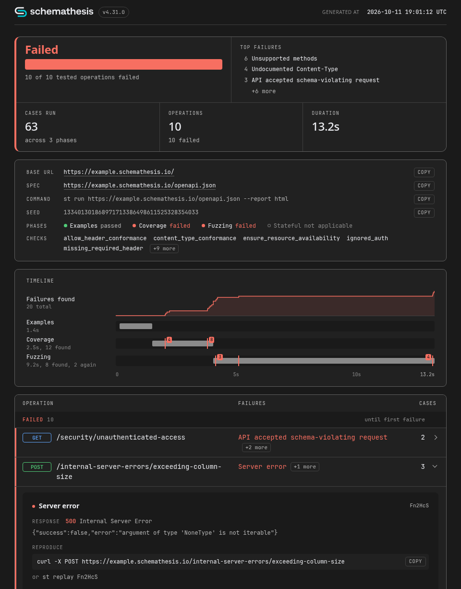

# HTML Report

`--report html` writes the run to one page that opens offline, so you can keep it as a CI artifact or attach it to a bug report.

```console
$ uvx schemathesis run https://example.schemathesis.io/openapi.json \
    --report html
...
Reports:
  - HTML: schemathesis-report/html-20261011T121716Z/index.html
```

Pass `--report-html-path ./html-report` for a fixed directory.

[](../img/html-report.png)

- The verdict counts tests only; an amber line explains any other non-zero exit.
- Warnings that can make a pass meaningless, like `401` everywhere, come first.
- Each failure shows the response, a `curl` command and [`st replay`](crash-reproduction.md).
- A filter bar narrows the operations by path, failure kind and method. Press `/` to search; the URL keeps the filters, so a filtered view can be shared.

## In CI

Upload the report even when the job fails; that is the run you want to read.

```yaml
- uses: schemathesis/action@v3
  with:
    schema: 'http://localhost:8080/openapi.json'
    args: '--report html'

- uses: actions/upload-artifact@v7
  if: always()
  with:
    name: schemathesis-html-report
    path: schemathesis-report/
```

## With pytest

Tests that use the pytest plugin write the same page when `schemathesis.toml` enables it:

```toml
[reports.html]
enabled = true
```

## Before Sharing

Schemathesis masks values whose [keys look sensitive](../reference/configuration.md#output), but writes response bodies as the API returned them. Read the bodies before you post the page anywhere public.
